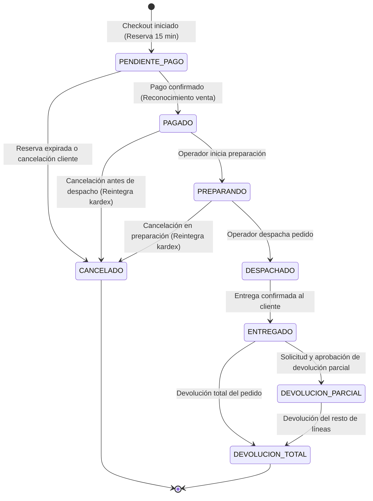
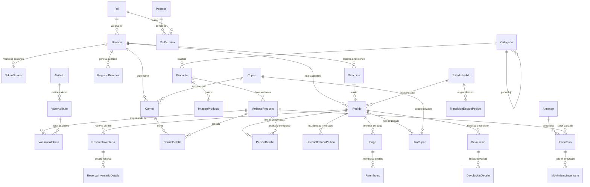

# ShopCart — E-Commerce Platform (Fase 1: Base de Datos & API REST)

> Plataforma transaccional B2C de alto rendimiento construida sobre **SQL Server 2022**, acceso a datos **100% mediante Procedimientos Almacenados** (cero ORM, cero SQL en backend), API RESTful en **Node.js 24 LTS (TypeScript en modo estricto)**, contratos fuertemente tipados con Zod, documentación interactiva **OpenAPI 3.0 (Swagger UI)** y suite de 115 pruebas de integración automatizadas.

---

## 1. Tabla de Contenidos
- [1. Tabla de Contenidos](#1-tabla-de-contenidos)
- [2. Aspectos Destacados y Reglas de Evaluación](#2-aspectos-destacados-y-reglas-de-evaluación)
- [3. Stack Tecnológico](#3-stack-tecnológico)
- [4. Credenciales de Demostración](#4-credenciales-de-demostración)
- [5. Guía de Inicio Rápido (Portabilidad en Máquina Limpia)](#5-guía-de-inicio-rápido-portabilidad-en-máquina-limpia)
- [6. Ejecución de Pruebas Automatizadas](#6-ejecución-de-pruebas-automatizadas)
- [7. Decisiones Técnicas y Arquitectura](#7-decisiones-técnicas-y-arquitectura)
- [8. Diagrama de Ciclo de Vida del Pedido (RF-07)](#8-diagrama-de-ciclo-de-vida-del-pedido-rf-07)
- [9. Diagrama Entidad-Relación (DER)](#9-diagrama-entidad-relación-der)
- [10. Catálogo Completo de la API REST](#10-catálogo-completo-de-la-api-rest)

---

## 2. Aspectos Destacados y Reglas de Evaluación

El sistema fue diseñado y construido para cumplir estrictamente con los criterios de evaluación oficial y evitar causales de penalización directa:

- **Cero ORM y Cero SQL en el Backend:** Todo el acceso a datos (lectura, inserción, actualización) se realiza **exclusivamente mediante Stored Procedures** (`dbo.SP_*`) con parámetros tipados vía el driver oficial `mssql`. No se utiliza Prisma, TypeORM, Sequelize ni consultas SQL en crudo.
- **Prevención Absoluta de SQL Injection:** Parámetros fuertemente tipados (`input` y `output`). Si un SP requiere SQL dinámico, utiliza `sp_executesql` con parámetros tipados.
- **Protección contra IDOR (Insecure Direct Object References):** Un cliente jamás puede consultar o modificar carritos, pedidos o direcciones de otro cliente. Las validaciones de propiedad se realizan a nivel de backend y en las restricciones relacionales de SQL Server (claves foráneas compuestas).
- **Rate Limiting y Protección Anti-Fuerza Bruta (Página 14 del Pliego - Extra Opcional):** Middleware de ventana deslizante en memoria en los endpoints de autenticación (`/auth/login` y `/auth/registro`). Limita a 5 intentos fallidos cada 15 minutos en login y 5 cuentas por hora en registro. Al exceder el umbral, responde de inmediato con HTTP `429 Too Many Requests`, cabeceras `Retry-After` y `X-RateLimit-*`, interrumpiendo la petición antes de invocar el cálculo intensivo de Argon2id o la base de datos para prevenir agotamiento de CPU (DoS).
- **Concurrencia y Control de Sobreventa:** Reservas temporales de inventario por 15 minutos en checkout atómico, respaldadas por restricciones `CHECK (CantidadReservada <= Existencia)` en el motor de base de datos.
- **Idempotencia Transaccional:** Registro de claves de idempotencia únicas en pedidos y pagos para evitar cobros o pedidos duplicados ante doble clic o reintentos de red.
- **Inmutabilidad Garantizada por Triggers:** La bitácora (`RegistroBitacora`), el Kardex (`MovimientoInventario`) y el historial de estados (`HistorialEstadoPedido`) cuentan con triggers `INSTEAD OF UPDATE, DELETE` que impiden su modificación o eliminación física.
- **Moneda e Impuestos:** Todos los montos se manejan en **Quetzales (GTQ)** con tipos `DECIMAL(12,2)` o `DECIMAL(14,2)` (prohibido `FLOAT`/`REAL`). Los precios de catálogo y pedidos incluyen **IVA del 12%**.

---

## 3. Stack Tecnológico

| Capa | Tecnología | Justificación |
|---|---|---|
| **Base de Datos** | Microsoft SQL Server 2022 | Motor relacional ACID de nivel empresarial con soporte de procedimientos almacenados, triggers inmutables e índices filtrados. |
| **Backend Runtime** | Node.js 24 LTS | Versión LTS más reciente, motor V8 optimizado y APIs nativas modernas. |
| **Lenguaje Backend** | TypeScript 5.8+ (`"strict": true`) | Tipado estático estricto, eliminación de errores en tiempo de compilación. |
| **Framework HTTP** | Express 4.21+ | Servidor REST ligero, desacoplado y estructurado mediante arquitectura por capas. |
| **Contratos y DTOs** | Zod 3.24+ (`packages/contracts`) | Validación bidireccional de esquemas en tiempo de ejecución compartida entre capas. |
| **Criptografía** | Argon2id (`argon2`) | Algoritmo de hash de contraseñas recomendado por OWASP y estándar RFC 9106. |
| **Tokens y Sesiones** | JWT (`jsonwebtoken`) + Rotación | Access Token (15 min) y Refresh Token persistido con rotación y detección de reuso por familias criptográficas. |
| **Pruebas** | Vitest 3.0+ & Supertest 7.0+ | Suite de pruebas de integración con cobertura completa de endpoints y base de datos real. |
| **Monorepo** | npm Workspaces | Estructura modular: `database`, `packages/contracts` y `backend`. |

---

## 4. Credenciales de Demostración

La base de datos incluye datos semilla reproducibles (`database/seeds/9002_usuarios_demo.sql`) con contraseñas hasheadas en Argon2id:

| Rol | Correo Electrónico | Contraseña | Permisos y Alcance |
|---|---|---|---|
| **Administrador** | `admin@shopcart.com` | `Admin1234!` | Acceso total: catálogo, precios, cupones, usuarios, auditoría y reportes ejecutivos. |
| **Operador** | `operador@shopcart.com` | `Operador1234!` | Gestión de pedidos (preparar, despachar), control de inventario y registro de kardex. |
| **Cliente** | `cliente@shopcart.com` | `Cliente1234!` | Carrito propio, compras, confirmación de pagos, pedidos propios y direcciones. |

---

## 5. Guía de Inicio Rápido (Portabilidad en Máquina Limpia)

El evaluador puede levantar el entorno completo en cualquier máquina con **Docker Desktop** y **Node.js 24 LTS** siguiendo estos pasos:

### Paso 1: Clonar el Repositorio
```bash
git clone <URL_DEL_REPOSITORIO> shopcart
cd shopcart
```

### Paso 2: Configurar Variables de Entorno
El repositorio incluye un archivo `.env.example` preconfigurado con valores listos para desarrollo local:
```bash
# En Windows (PowerShell):
Copy-Item .env.example .env

# En Linux/macOS:
cp .env.example .env
```

### Paso 3: Disponer de SQL Server (Docker o Instalación Local)
Tiene dos alternativas según su entorno de desarrollo:

- **Opción A (Con Docker Desktop - Recomendado si no tiene SQL Server):**  
  El archivo `docker-compose.yml` en la raíz contiene la definición oficial de SQL Server 2022 lista para desarrollo:
  ```bash
  docker compose up -d sqlserver
  ```
  > *Espere unos 10-15 segundos mientras el contenedor inicializa los servicios de SQL Server.*

- **Opción B (Instalación nativa de SQL Server / SQL Server Express):**  
  No requiere Docker. Solo asegúrese de que el servicio de SQL Server esté en ejecución (con autenticación mixta habilitada en el puerto 1433) y configure sus credenciales locales en el archivo `.env` (`DB_HOST`, `DB_PORT`, `DB_USER`, `SA_PASSWORD`).

### Paso 4: Instalar Dependencias del Monorepo
Instale las dependencias de todos los workspaces (`database`, `packages/contracts`, `backend`):
```bash
npm install
```

### Paso 5: Compilar Contratos y Aplicar Migraciones de Base de Datos
Este comando compilará los esquemas Zod en `packages/contracts`, creará la base de datos `ShopCart`, aplicará las migraciones de tablas (`0001` a `0006`), compilará las vistas y Stored Procedures (`0200` a `0210`) y cargará las semillas demo (`9001` y `9002`):
```bash
npm run build:contracts
npm run db:migrate
```

### Paso 6: Iniciar el Servidor Backend
Inicie el servidor de desarrollo en caliente:
```bash
npm run dev:backend
```
El servidor estará escuchando en `http://localhost:3000/api/v1`.  
Puede verificar la salud del servicio ingresando a:  
**`GET http://localhost:3000/api/v1/health`**

#### Documentación Interactiva Swagger UI (OpenAPI 3.0):
El backend expone la interfaz interactiva de Swagger para que el evaluador pueda explorar y probar todos los endpoints directamente desde el navegador con soporte de autenticación Bearer JWT:
- **Swagger UI:** [`http://localhost:3000/api/docs`](http://localhost:3000/api/docs)
- **Especificación OpenAPI (JSON):** [`http://localhost:3000/api/docs.json`](http://localhost:3000/api/docs.json)

> **Tip para el Evaluador:**  
> En Swagger UI, ejecute **`POST /auth/login`** con las credenciales demo (`admin@shopcart.com` / `Admin1234!`), copie el `accessToken` resultante y use el botón verde **Authorize** arriba a la derecha para habilitar las pruebas de todos los endpoints protegidos.

> **Alcance de la Fase 1:**  
> Esta entrega corresponde exclusivamente al **Backend & Base de Datos** (Fase 1). Toda la interacción, prueba de flujos y verificación de requerimientos funcionales (RF-01 a RF-09) se realiza a través de la interfaz interactiva de **Swagger UI** y la suite de pruebas de integración automatizadas.

---

## 6. Ejecución de Pruebas Automatizadas

El backend incluye una suite de pruebas de integración con **115 pruebas automatizadas** que interactúan directamente con la base de datos SQL Server y verifican casos borde, concurrencia, idempotencia, transiciones inválidas y control de acceso:

Para ejecutar todas las pruebas:
```bash
npm --workspace=backend run test:all
```

Resumen de suites de pruebas integradas:
- `auth.test.ts` (9 pruebas): Registro, login, hash Argon2id, renovación de token por rotación y detección de reuso.
- `auth_ratelimit.test.ts` (2 pruebas): Protección anti-fuerza bruta en login (HTTP 401 decrementa intentos restantes, HTTP 429 bloquea al 6º intento con Retry-After sin tocar la base de datos).
- `usuarios.test.ts` (15 pruebas): CRUD de usuarios, asignación de roles, desactivación lógica y permisos RBAC.
- `direcciones.test.ts` (13 pruebas): Gestión de direcciones, predeterminadas e integridad referencial por cliente.
- `catalogo.test.ts` (17 pruebas): Jerarquía de categorías, productos, variantes con SKU, precios y búsqueda textual.
- `inventario.test.ts` (12 pruebas): Existencias, alertas de stock, entradas/salidas y cálculo estricto del Kardex inmutable.
- `carrito_cupones.test.ts` (11 pruebas): Carrito persistente (invitados/clientes), aplicación de cupones y límites de uso.
- `checkout_pedidos.test.ts` (14 pruebas): Reservas temporales (15 min), checkout atómico, pagos idempotentes y devoluciones.
- `reportes.test.ts` (11 pruebas): Métricas del dashboard, ventas agrupadas (día/semana/mes), exclusión de cancelados y deducción de reembolsos.
- `bitacora_catalogos.test.ts` (8 pruebas): Consulta de bitácora inmutable y catálogos del sistema.
- `swagger.test.ts` (3 pruebas): Verificación de disponibilidad de la especificación OpenAPI JSON y renderizado de Swagger UI.

---

## 7. Decisiones Técnicas y Arquitectura

### 7.1. Arquitectura por Capas Estrictas
Cada módulo del backend (`backend/src/modules/<modulo>/`) implementa una separación unidireccional de responsabilidades:
1. **`routes`:** Define rutas Express, asigna middlewares de autenticación (`autenticar`), autorización RBAC (`autorizarPermiso`) y validación de esquemas Zod (`validar`).
2. **`controller`:** Recibe la petición HTTP, invoca al servicio y formatea la respuesta JSON estándar.
3. **`service`:** Orquesta la lógica de negocio, reglas de dominio y coordinación entre entidades.
4. **`dal` (Data Access Layer):** Invoca exclusivamente los Stored Procedures mediante el helper `ejecutarSp` con parámetros fuertemente tipados. **Cero SQL en código TypeScript.**

### 7.2. Estrategia de Acceso a Datos y Stored Procedures
- Todas las operaciones en la base de datos están encapsuladas en Stored Procedures (`SP_Modulo_Proceso`).
- Las vistas (`VW_Modulo_Proceso`) se utilizan para agregaciones y dashboards consolidados.
- La función de ejecución centralizada (`ejecutarSp.ts`) mapea códigos de error SQL estándar `THROW 50xxx` a excepciones HTTP estructuradas (`ConflictError`, `NotFoundError`, `UnauthorizedError`, `BadRequestError`).

### 7.3. Manejo de Concurrencia y Alta Demanda
- **Checkout Atómico:** Al iniciar checkout, se crea una reserva temporal de existencias en `dbo.ReservaInventario` por 15 minutos (`FechaExpiracion = DATEADD(MINUTE, 15, SYSUTCDATETIME())`).
- **Prevención de Sobreventa:** La tabla `dbo.Inventario` cuenta con la restricción `CHECK (CantidadReservada <= Existencia)`. A nivel de SP, la reserva se ejecuta con bloqueos de actualización (`UPDLOCK, ROWLOCK`), asegurando que si dos clientes intentan comprar la última unidad en el mismo milisegundo, solo uno adquiere la reserva y el otro recibe `409 Conflict`.
- **Liberación de Reservas Vencidas:** Procedimiento `SP_Reservas_LiberarExpiradas` que libera reservas vencidas reintegrando la disponibilidad de existencias sin intervención manual.

### 7.4. Idempotencia en Pagos
- La tabla `dbo.Pago` mantiene la restricción de unicidad `UQ_Pago_Idempotencia (ClaveIdempotencia)`.
- Si un cliente presiona dos veces el botón de pago o se produce un reintento de red, la segunda petición detecta la clave de idempotencia existente y retorna la confirmación del intento previo sin duplicar el cobro ni el pedido.

### 7.5. Rate Limiting y Protección Anti-Fuerza Bruta (Extra Opcional Pág. 14)
- **Mitigación DoS por Hash Argon2id:** Argon2id es un algoritmo intencionalmente intensivo en memoria y CPU para neutralizar ataques con GPU/ASIC. Sin límite de peticiones, ráfagas de logins no autorizados podrían saturar el procesador del servidor.
- **Ventana Deslizante en Memoria:** Middleware sin dependencias externas pesadas que rastrea intentos por IP:
  - `rateLimitLogin`: Máximo 5 intentos fallidos en una ventana de 15 minutos.
  - `rateLimitRegistro`: Máximo 5 cuentas creadas por hora por IP.
- **Respuesta Estándar RFC:** Al superar el límite, responde inmediatamente con código HTTP `429 Too Many Requests`, cabeceras `Retry-After: <segundos>` y `X-RateLimit-*`, alertando al cliente o consumidor de la API con el tiempo de espera requerido antes de permitir un nuevo intento y bloqueando el consumo innecesario de recursos en el servidor.

---

## 8. Diagrama de Ciclo de Vida del Pedido (RF-07)

El ciclo de vida del pedido se rige por la tabla `dbo.TransicionEstadoPedido`, impidiendo cualquier transición no autorizada tanto a nivel de backend como mediante el trigger `dbo.TR_Pedido_ValidarTransicion`:



---

## 9. Diagrama Entidad-Relación (DER)

El modelo de datos normalizado (3FN) consta de 18 tablas diseñadas en SQL Server 2022:



---

## 10. Catálogo Completo de la API REST

Todos los endpoints están bajo el prefijo `/api/v1`:

### 10.1. Módulo de Autenticación (`/auth`)
| Método | Endpoint | Roles | Descripción |
|---|---|---|---|
| `POST` | `/auth/registro` | Público | Registro de cliente con contraseña Argon2id. |
| `POST` | `/auth/login` | Público | Autenticación de usuario; emite Access Token y Refresh Token (cookie HttpOnly). |
| `POST` | `/auth/refresh` | Público | Renovación transparente de tokens con rotación estricta y detección de reuso. |
| `POST` | `/auth/logout` | Autenticado | Cierre de sesión y revocación del refresh token. |
| `GET` | `/auth/perfil` | Autenticado | Consulta del perfil del usuario autenticado. |

### 10.2. Módulo de Catálogo de Productos (`/catalogo`)
| Método | Endpoint | Roles | Descripción |
|---|---|---|---|
| `GET` | `/catalogo/categorias` | Público | Listado jerárquico de categorías activas. |
| `POST` | `/catalogo/categorias` | Admin | Creación de categoría (`catalog.manage`). |
| `PUT` | `/catalogo/categorias/:id` | Admin | Modificación de categoría (`catalog.manage`). |
| `GET` | `/catalogo/productos` | Público | Búsqueda y listado paginado con filtros por precio, categoría y stock. |
| `GET` | `/catalogo/productos/:slug`| Público | Detalle de producto con todas sus variantes y atributos. |
| `POST` | `/catalogo/productos` | Admin | Creación de producto con variantes atómicas (`catalog.manage`). |
| `PUT` | `/catalogo/productos/:id` | Admin | Modificación de producto (`catalog.manage`). |
| `DELETE` | `/catalogo/productos/:id` | Admin | Desactivación lógica de producto con ventas previas (`catalog.manage`). |

### 10.3. Módulo de Inventario y Kardex (`/inventario`)
| Método | Endpoint | Roles | Descripción |
|---|---|---|---|
| `GET` | `/inventario` | Operador / Admin | Existencias consolidadas por almacén con alerta de punto de reorden. |
| `POST` | `/inventario/entrada` | Operador / Admin | Entrada física por compra con generación automática de Kardex. |
| `POST` | `/inventario/ajuste` | Operador / Admin | Ajuste de inventario con motivo obligatorio. |
| `GET` | `/inventario/kardex` | Operador / Admin | Historial inmutable de movimientos del Kardex con paginación y filtros. |

### 10.4. Módulo de Carrito de Compras (`/carrito`)
| Método | Endpoint | Roles | Descripción |
|---|---|---|---|
| `GET` | `/carrito` | Cliente / Invitado | Obtiene el carrito activo, subtotal, impuestos y descuentos. |
| `POST` | `/carrito/items` | Cliente / Invitado | Agrega variante al carrito validando stock disponible en tiempo real. |
| `PATCH` | `/carrito/items/:idVariante` | Cliente / Invitado | Modifica la cantidad de una línea del carrito. |
| `DELETE` | `/carrito/items/:idVariante` | Cliente / Invitado | Elimina una variante del carrito. |
| `DELETE` | `/carrito` | Cliente / Invitado | Vacía el carrito activo por completo. |

### 10.5. Módulo de Cupones y Promociones (`/cupones`)
| Método | Endpoint | Roles | Descripción |
|---|---|---|---|
| `POST` | `/cupones/aplicar` | Cliente / Invitado | Valida y aplica un cupón de descuento al carrito activo. |
| `DELETE` | `/cupones/remover` | Cliente / Invitado | Remueve el cupón aplicado al carrito. |
| `GET` | `/cupones` | Admin | Listado administrativo de cupones con contador de usos. |
| `POST` | `/cupones` | Admin | Creación de cupón con límites de uso total y por cliente. |

### 10.6. Módulo de Checkout y Pagos (`/checkout`)
| Método | Endpoint | Roles | Descripción |
|---|---|---|---|
| `POST` | `/checkout/iniciar` | Cliente | Inicia checkout atómico, crea pedido y reserva existencias por 15 min. |
| `POST` | `/checkout/confirmar-pago` | Cliente | Confirma el pago con clave de idempotencia, consume reserva y crea Kardex de salida. |

### 10.7. Módulo de Pedidos y Devoluciones (`/pedidos` & `/devoluciones`)
| Método | Endpoint | Roles | Descripción |
|---|---|---|---|
| `GET` | `/pedidos/mis-pedidos` | Cliente | Listado de pedidos propios (protección estricta contra IDOR). |
| `GET` | `/pedidos/:id` | Cliente / Admin | Detalle completo de pedido, líneas, precios congelados y pagos. |
| `GET` | `/pedidos/admin` | Operador / Admin | Listado administrativo de pedidos con filtros por estado, cliente y fechas. |
| `POST` | `/pedidos/:id/cambiar-estado` | Operador / Admin | Transición de estado de pedido validada por matriz de estados. |
| `POST` | `/devoluciones` | Cliente | Solicitud de devolución parcial o total de líneas de pedido. |

### 10.8. Módulo de Dashboard y Reportes (`/reportes`)
| Método | Endpoint | Roles | Descripción |
|---|---|---|---|
| `GET` | `/reportes/dashboard` | Admin | KPIs ejecutivos del día, ticket promedio del mes y carritos abandonados. |
| `GET` | `/reportes/ventas-periodo` | Admin | Ventas netas y pedidos agrupados por día, semana o mes. |
| `GET` | `/reportes/top-productos` | Admin | Top N productos más vendidos por unidades y volumen neto generado. |
| `GET` | `/reportes/ventas-categoria`| Admin | Ventas y unidades por categoría (respaldado por `VW_Dashboard_VentasPorCategoria`). |
| `GET` | `/reportes/carritos-abandonados`| Admin | Listado paginado de carritos inactivos según umbral de horas. |

### 10.9. Módulo de Auditoría (`/bitacora`)
| Método | Endpoint | Roles | Descripción |
|---|---|---|---|
| `GET` | `/bitacora` | Admin | Consulta paginada de la bitácora inmutable con filtro por módulo y fecha. |
