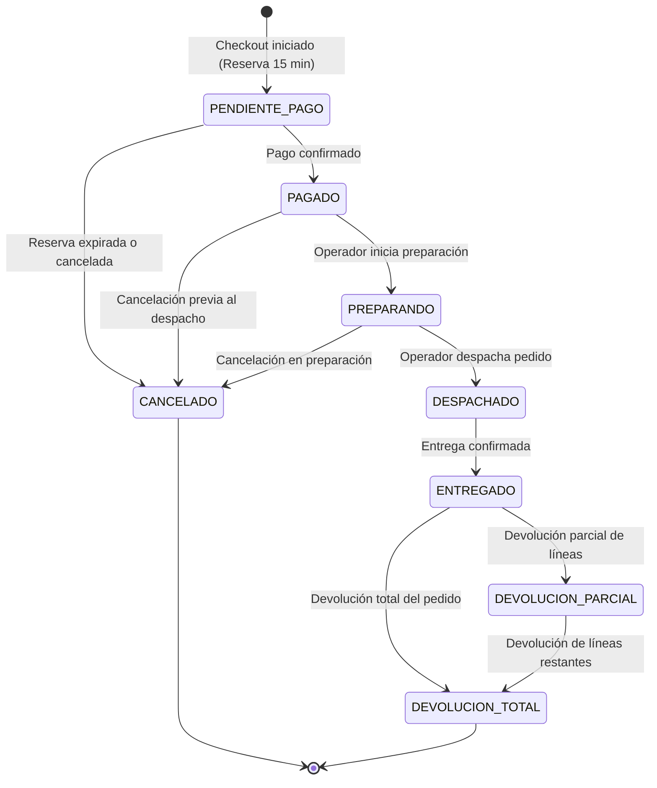
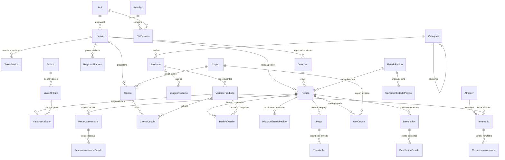

# ShopCart — API & Base de Datos

Backend y base de datos relacional para la plataforma de comercio electrónico ShopCart. El sistema implementa la gestión de catálogo de productos, control de inventario con Kardex, carrito de compras, cupones de descuento, checkout transaccional con reservas temporales y administración de pedidos por estados.

---

## 1. Contenido
- [1. Contenido](#1-contenido)
- [2. Consideraciones Técnicas](#2-consideraciones-técnicas)
- [3. Stack Tecnológico](#3-stack-tecnológico)
- [4. Credenciales de Prueba](#4-credenciales-de-prueba)
- [5. Instalación y Puesta en Marcha](#5-instalación-y-puesta-en-marcha)
- [6. Pruebas Automatizadas](#6-pruebas-automatizadas)
- [7. Arquitectura y Decisiones de Diseño](#7-arquitectura-y-decisiones-de-diseño)
- [8. Ciclo de Vida del Pedido](#8-ciclo-de-vida-del-pedido)
- [9. Diagrama Entidad-Relación](#9-diagrama-entidad-relación)
- [10. Endpoints de la API](#10-endpoints-de-la-api)

---

## 2. Consideraciones Técnicas

- **Acceso a datos por Procedimientos Almacenados:** Toda la persistencia y lectura de datos se realiza a través de Stored Procedures (`dbo.SP_*`) con parámetros tipados mediante el driver oficial `mssql`. No se utilizan ORMs ni consultas SQL dinámicas en el código backend.
- **Prevención de inyección SQL:** Todos los parámetros se envían tipados. En los casos donde se requiere armado dinámico de consultas (búsquedas con filtros combinados), se utiliza `sp_executesql` con definición estricta de parámetros.
- **Control de acceso y aislamiento entre clientes (IDOR):** Las rutas de pedidos, direcciones y carrito validan la pertenencia del recurso usando el `idUsuario` del token JWT verificado, impidiendo que un cliente acceda a información de otros usuarios.
- **Control de concurrencia e inventario:** Durante el checkout se genera una reserva temporal por 15 minutos en `dbo.ReservaInventario`. La tabla `dbo.Inventario` previene sobreventas mediante la restricción `CHECK (CantidadReservada <= Existencia)` y bloqueos `UPDLOCK, ROWLOCK` en el procedimiento almacenado. Las reservas vencidas se liberan automáticamente mediante `SP_Reservas_LiberarExpiradas`.
- **Idempotencia en pagos:** El registro de pagos utiliza la restricción única `UQ_Pago_Idempotencia (ClaveIdempotencia)`. Si se reenvía una misma solicitud por fallas de red o doble clic, el sistema devuelve la respuesta del intento previo sin procesar un nuevo cobro ni duplicar el pedido.
- **Inmutabilidad de registros:** Las tablas `dbo.RegistroBitacora`, `dbo.MovimientoInventario` (Kardex) y `dbo.HistorialEstadoPedido` cuentan con triggers `INSTEAD OF UPDATE, DELETE` que impiden su modificación o borrado.
- **Moneda e impuestos:** Los valores monetarios se gestionan en Quetzales (GTQ) con tipo `DECIMAL` (sin uso de `FLOAT` ni `REAL`). Los precios de venta tienen el 12% de IVA incluido.
- **Protección contra fuerza bruta:** Middleware de ventana deslizante en memoria que limita los intentos fallidos de autenticación (5 intentos por 15 minutos en login y 5 registros por hora por IP), respondiendo con HTTP `429 Too Many Requests` y cabecera `Retry-After`.

---

## 3. Stack Tecnológico

| Componente | Tecnología | Detalle |
|---|---|---|
| **Base de Datos** | Microsoft SQL Server 2022 | Procedimientos almacenados, triggers, restricciones y tipos `DECIMAL`. |
| **Entorno** | Node.js 24 LTS | Runtime de ejecución backend. |
| **Lenguaje** | TypeScript 5.8+ | Configurado en modo estricto (`"strict": true`). |
| **Framework HTTP** | Express 4.21+ | API RESTful estructurada en capas (`routes`, `controller`, `service`, `dal`). |
| **Contratos y Validación** | Zod 3.24+ | Esquemas compartidos en `packages/contracts` para validar entradas y tipar DTOs. |
| **Hashing de Contraseñas** | Argon2id | Algoritmo de derivación de claves según recomendaciones OWASP. |
| **Autenticación** | JWT | Access Token de corta duración (15 min) y Refresh Token con rotación persistida en base de datos. |
| **Pruebas** | Vitest & Supertest | Suite de pruebas de integración contra base de datos real. |
| **Monorepo** | npm Workspaces | Estructura modular dividida en `database`, `packages/contracts` y `backend`. |

---

## 4. Credenciales de Prueba

Los datos semilla (`database/seeds/9002_usuarios_demo.sql`) proveen tres cuentas de prueba con contraseñas generadas con Argon2id:

| Rol | Correo | Contraseña | Alcance |
|---|---|---|---|
| **Administrador** | `admin@shopcart.com` | `Admin1234!` | Acceso completo: catálogo, precios, cupones, usuarios, bitácora y reportes. |
| **Operador** | `operador@shopcart.com` | `Operador1234!` | Gestión de pedidos (preparar, despachar) y movimientos de inventario/kardex. |
| **Cliente** | `cliente@shopcart.com` | `Cliente1234!` | Carrito de compras, checkout, historial de pedidos propios y direcciones. |

---

## 5. Instalación y Puesta en Marcha

### Requisitos previos
- Node.js 24 LTS o superior y npm.
- Instancia de SQL Server 2019 o 2022 (local o mediante Docker).

### Paso 1: Clonar el repositorio
```bash
git clone <URL_DEL_REPOSITORIO> shopcart
cd shopcart
```

### Paso 2: Variables de entorno
Copiar el archivo de ejemplo:
```bash
# PowerShell
Copy-Item .env.example .env

# Bash
cp .env.example .env
```
Si se utiliza una instancia local de SQL Server, ajustar los valores de conexión (`DB_HOST`, `DB_PORT`, `DB_USER`, `SA_PASSWORD`) según corresponda.

### Paso 3: Inicializar la base de datos
Si se utiliza Docker:
```bash
docker compose up -d sqlserver
```
*(Esperar unos segundos a que el contenedor complete su inicialización).*

Si se utiliza una instalación local de SQL Server, verificar que el servicio esté activo y con autenticación mixta habilitada en el puerto 1433.

### Paso 4: Instalar dependencias
```bash
npm install
```

### Paso 5: Compilar contratos y ejecutar migraciones
```bash
npm run build:contracts
npm run db:migrate
npm run db:seed
```
Este proceso compila los contratos Zod, crea la estructura de la base de datos, compila los procedimientos almacenados y carga los datos de prueba.

### Paso 6: Iniciar el servidor backend
```bash
npm run dev:backend
```
El servicio estará disponible en `http://localhost:3000/api/v1`.

- Verificación de estado: `GET http://localhost:3000/api/v1/health`
- Documentación Swagger UI: `http://localhost:3000/api/docs`
- Especificación OpenAPI JSON: `http://localhost:3000/api/docs.json`

> **Pruebas en Swagger UI:**  
> Para probar endpoints protegidos desde Swagger, ejecutar `POST /auth/login` con la cuenta de administrador, copiar el `accessToken` de la respuesta e ingresarlo en el botón **Authorize** de la parte superior derecha.

---

## 6. Pruebas Automatizadas

El backend incluye una suite de pruebas de integración con 115 casos que interactúan directamente con la base de datos para verificar reglas de negocio, concurrencia, transiciones de estado, idempotencia y permisos:

```bash
npm --workspace=backend run test:all
```

Suites incluidas:
- `auth.test.ts` (9 pruebas): Registro, inicio de sesión, hash Argon2id, rotación y revocación de tokens.
- `auth_ratelimit.test.ts` (2 pruebas): Bloqueo tras intentos fallidos consecutivos (HTTP 429).
- `usuarios.test.ts` (15 pruebas): Gestión de usuarios, roles y desactivación lógica.
- `direcciones.test.ts` (13 pruebas): CRUD de direcciones y aislamiento por cliente.
- `catalogo.test.ts` (17 pruebas): Categorías, productos, variantes con SKU, precios y búsquedas.
- `inventario.test.ts` (12 pruebas): Entradas, ajustes con motivo y validación de Kardex.
- `carrito_cupones.test.ts` (11 pruebas): Operaciones de carrito, cupones y límites de uso.
- `checkout_pedidos.test.ts` (14 pruebas): Reservas de stock, checkout transaccional y devoluciones.
- `reportes.test.ts` (11 pruebas): Métricas de ventas, exclusión de pedidos cancelados y deducción de reembolsos.
- `bitacora_catalogos.test.ts` (8 pruebas): Consulta de bitácora y catálogos de roles/permisos.
- `swagger.test.ts` (3 pruebas): Disponibilidad de documentación OpenAPI y Swagger UI.

---

## 7. Arquitectura y Decisiones de Diseño

### Capas del backend
Cada módulo (`backend/src/modules/<modulo>/`) implementa un flujo unidireccional:
1. **`routes`:** Registro de rutas Express con validación de esquemas Zod (`validar`) y middlewares de autenticación (`autenticar`) y autorización (`autorizarRoles` / `autorizarPermiso`).
2. **`controller`:** Manejo de la solicitud HTTP y formateo de la respuesta JSON estándar.
3. **`service`:** Lógica de negocio y reglas de dominio.
4. **`dal` (Data Access Layer):** Invocación de Stored Procedures a través del helper `ejecutarSp` con parámetros tipados. No contiene sentencias SQL manuales.

### Mapeo de errores
Los errores generados en SQL Server mediante `THROW 50xxx` se capturan en la capa DAL y se traducen a excepciones HTTP estructuradas (`AppError`), produciendo respuestas JSON uniformes con su correspondiente código de estado (400, 401, 403, 404, 409).

---

## 8. Ciclo de Vida del Pedido

El flujo de estados se controla mediante la tabla `dbo.TransicionEstadoPedido` y el trigger `dbo.TR_Pedido_ValidarTransicion`:



---

## 9. Diagrama Entidad-Relación

Modelo relacional en tercera forma normal (3FN) con 18 tablas:



---

## 10. Endpoints de la API

Prefijo base: `/api/v1`

### 10.1. Autenticación (`/auth`)
| Método | Endpoint | Acceso | Descripción |
|---|---|---|---|
| `POST` | `/auth/registro` | Público | Registro de cliente con contraseña Argon2id. |
| `POST` | `/auth/login` | Público | Autenticación de usuario; emite Access Token y Refresh Token. |
| `POST` | `/auth/google` | Público | Autenticación mediante Google OAuth. |
| `POST` | `/auth/refresh` | Público | Renovación de token con rotación y detección de reuso. |
| `POST` | `/auth/logout` | Autenticado | Revocación del refresh token de la sesión activa. |
| `GET` | `/auth/yo` | Autenticado | Información del usuario autenticado y sus permisos. |

### 10.2. Catálogo de Productos (`/catalogo`)
| Método | Endpoint | Acceso | Descripción |
|---|---|---|---|
| `GET` | `/catalogo/categorias` | Público | Listado de categorías activas. |
| `POST` | `/catalogo/categorias` | Administrador | Creación de categoría. |
| `PUT` | `/catalogo/categorias/:id` | Administrador | Modificación de categoría. |
| `PATCH` | `/catalogo/categorias/:id/estado` | Administrador | Cambio de estado de categoría. |
| `GET` | `/catalogo/atributos` | Público | Listado de atributos y valores. |
| `POST` | `/catalogo/atributos` | Administrador | Creación de atributo. |
| `POST` | `/catalogo/atributos/:id/valores` | Administrador | Creación de valor de atributo. |
| `GET` | `/catalogo/productos` | Público | Búsqueda y listado con filtros por precio, categoría y stock. |
| `GET` | `/catalogo/productos/:idOrSlug` | Público | Detalle de producto con variantes y atributos. |
| `POST` | `/catalogo/productos` | Administrador | Creación de producto y variantes. |
| `PUT` | `/catalogo/productos/:id` | Administrador | Modificación de producto. |
| `PATCH` | `/catalogo/productos/:id/estado` | Administrador | Desactivación o activación de producto. |
| `PATCH` | `/catalogo/variantes/:id` | Administrador | Actualización de precio o atributos de variante. |
| `POST` | `/catalogo/imagenes/subir` | Administrador | Subida y optimización de imágenes en formato WebP. |

### 10.3. Inventario y Kardex (`/inventario`)
| Método | Endpoint | Acceso | Descripción |
|---|---|---|---|
| `GET` | `/inventario` | Operador / Administrador | Existencias consolidadas por variante. |
| `GET` | `/inventario/kardex` | Operador / Administrador | Historial de movimientos de inventario con filtros. |
| `GET` | `/inventario/variante/:idVariante` | Operador / Administrador | Detalle de existencias de una variante. |
| `POST` | `/inventario/entrada` | Operador / Administrador | Registro de entrada de inventario por compra. |
| `POST` | `/inventario/ajuste` | Operador / Administrador | Ajuste manual de stock con motivo obligatorio. |
| `PUT` | `/inventario/punto-reorden` | Operador / Administrador | Configuración de umbral de reorden. |

### 10.4. Carrito de Compras (`/carrito`)
| Método | Endpoint | Acceso | Descripción |
|---|---|---|---|
| `GET` | `/carrito` | Cliente / Invitado | Consulta de carrito activo con totales e impuestos. |
| `POST` | `/carrito/items` | Cliente / Invitado | Agrega variante validando existencia disponible. |
| `PUT` | `/carrito/items/:idVariante` | Cliente / Invitado | Modifica cantidad de una variante. |
| `DELETE` | `/carrito/items/:idVariante` | Cliente / Invitado | Elimina una variante del carrito. |
| `DELETE` | `/carrito` | Cliente / Invitado | Vacía el carrito activo. |
| `POST` | `/carrito/cupon` | Cliente / Invitado | Aplica cupón de descuento al carrito. |
| `DELETE` | `/carrito/cupon` | Cliente / Invitado | Remueve el cupón del carrito. |
| `POST` | `/carrito/migrar` | Cliente | Asocia el carrito de invitado al cliente al iniciar sesión. |

### 10.5. Cupones de Descuento (`/cupones`)
| Método | Endpoint | Acceso | Descripción |
|---|---|---|---|
| `GET` | `/cupones` | Administrador | Listado de cupones con contador de usos. |
| `POST` | `/cupones` | Administrador | Creación de cupón con límites de uso total y por cliente. |

### 10.6. Checkout y Pagos (`/checkout`)
| Método | Endpoint | Acceso | Descripción |
|---|---|---|---|
| `POST` | `/checkout/iniciar` | Cliente | Crea pedido y reserva existencias por 15 minutos. |
| `POST` | `/checkout/confirmar-pago` | Cliente | Confirma el pago con clave de idempotencia y aplica salida en Kardex. |

### 10.7. Pedidos y Devoluciones (`/pedidos` & `/devoluciones`)
| Método | Endpoint | Acceso | Descripción |
|---|---|---|---|
| `GET` | `/pedidos/mis-pedidos` | Cliente | Listado de pedidos propios. |
| `GET` | `/pedidos/admin` | Operador / Administrador | Listado de pedidos con filtros por estado, cliente y fechas. |
| `GET` | `/pedidos/:id` | Cliente / Operador / Admin | Detalle del pedido (acceso validado por IDOR). |
| `POST` | `/pedidos/:id/cambiar-estado` | Operador / Administrador | Avance de estado de pedido. |
| `POST` | `/devoluciones` | Cliente / Operador / Admin | Solicitud o registro de devolución por línea. |

### 10.8. Direcciones (`/direcciones`)
| Método | Endpoint | Acceso | Descripción |
|---|---|---|---|
| `GET` | `/direcciones` | Cliente | Listado de direcciones del cliente autenticado. |
| `POST` | `/direcciones` | Cliente | Registro de nueva dirección de entrega. |
| `GET` | `/direcciones/:id` | Cliente | Detalle de dirección propia. |
| `PUT` | `/direcciones/:id` | Cliente | Actualización de dirección propia. |
| `DELETE` | `/direcciones/:id` | Cliente | Eliminación de dirección propia. |
| `PATCH` | `/direcciones/:id/predeterminada` | Cliente | Marca dirección como predeterminada. |

### 10.9. Reportes y Métricas (`/reportes`)
| Método | Endpoint | Acceso | Descripción |
|---|---|---|---|
| `GET` | `/reportes/dashboard` | Administrador | Métricas generales del día y mes. |
| `GET` | `/reportes/ventas-periodo` | Administrador | Ventas y pedidos agrupados por día, semana o mes. |
| `GET` | `/reportes/top-productos` | Administrador | Productos más vendidos por unidades y monto. |
| `GET` | `/reportes/ventas-categoria` | Administrador | Ventas agrupadas por categoría. |
| `GET` | `/reportes/carritos-abandonados` | Administrador | Listado de carritos inactivos según umbral. |

### 10.10. Usuarios y Seguridad (`/usuarios` & `/catalogos`)
| Método | Endpoint | Acceso | Descripción |
|---|---|---|---|
| `GET` | `/usuarios` | Administrador | Listado paginado de usuarios con filtros por rol y estado. |
| `POST` | `/usuarios` | Administrador | Creación de personal interno (Operador o Administrador). |
| `GET` | `/usuarios/:id` | Administrador | Detalle completo de usuario. |
| `PUT` | `/usuarios/:id` | Administrador | Actualización de datos de usuario. |
| `PATCH` | `/usuarios/:id/estado` | Administrador | Activación o desactivación de cuenta. |
| `GET` | `/catalogos/roles` | Administrador | Listado de roles disponibles. |
| `GET` | `/catalogos/permisos` | Administrador | Listado de permisos del sistema. |

### 10.11. Auditoría (`/bitacora`)
| Método | Endpoint | Acceso | Descripción |
|---|---|---|---|
| `GET` | `/bitacora` | Administrador | Consulta de bitácora con filtro por módulo y fechas. |
